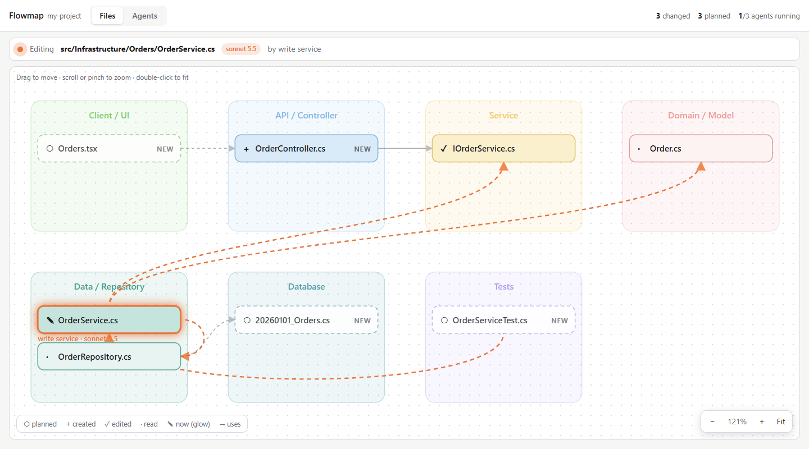
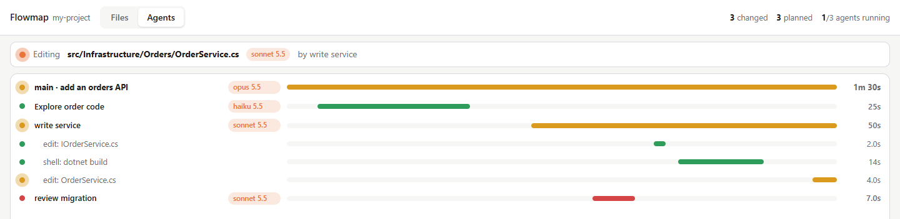

# Flowmap

A Claude Code mod that shows what Claude is doing, live: which agents run on which model, which
files it plans, reads and edits, how those files relate, the one it is working on right now, and
the assumptions it makes along the way.

<picture>
  <source media="(prefers-color-scheme: dark)" srcset="docs/files-dark.png">
  
</picture>

- **Sidebar** in Claude Code with three tabs: **Files** (an architecture map grouped into
  Client → API → Service → Domain → Data → Database, plus Tests and Docs), **Agents** (the main
  loop and each subagent with its model, tool calls and durations) and **Assumptions** (what Claude
  took for granted, how sure it was, and why).
- **Browser view**: the same map as a full-screen diagram you can drag, zoom and pinch, with the
  layers wrapped to fit your screen, plus a timeline of the agents and the assumptions grouped by prompt.
- **Planned files**: Claude calls the mod's `plan_files` tool before multi-file changes, so the files
  it is about to create show as dashed `NEW` / `PLAN` cards before they exist.
- **Assumptions**: Claude calls the mod's `note_assumptions` tool whenever it assumes something you
  didn't say and it didn't check, so you can catch a wrong one before it is built on. Low-confidence
  ones are flagged red, and their count shows on the browser tab.



Works in any terminal, Windows included: the sidebar is plain text and the diagram opens in your browser.

## Install

At the prompt of a Claude Code terminal session:

```
/plugin install flowmap --marketplace adityaraj-tz/FlowMap-Claude-Mod
```

From a shell:

```sh
claude plugin install flowmap --marketplace adityaraj-tz/FlowMap-Claude-Mod
```

In the desktop app: click **+** next to the prompt box, then **Plugins**, **Add marketplace** with
`adityaraj-tz/FlowMap-Claude-Mod`, then **Add plugin**.

## Use

| Do | Type |
| --- | --- |
| Open the sidebar | `/flowmap`, then `f` Files · `a` Agents · `s` Assumptions · `b` browser · `q` close |
| Open the full-screen diagram | `/flowmap web` |
| Jump straight to a tab | `/flowmap files`, `/flowmap agents` or `/flowmap assumptions` |
| Start the map over (files, links and assumptions) | `/flowmap clear` |

In the browser: drag to move, scroll or pinch to zoom, double-click or **Fit** to fit the screen.
It refreshes every 2 seconds and keeps your zoom; until you move it, it re-fits as files arrive.

If Claude starts a multi-file change without planning it, ask it to "plan the files on flowmap first".

## Legend

| Mark | Meaning |
| --- | --- |
| `○` dashed | planned, not touched yet |
| `+` | created |
| `✓` | edited |
| `·` | read |
| `✎` glowing | being edited now, with the model doing it |
| arrow | the file uses / names the other file's type |
| `?` red · `~` yellow · `✓` green | an assumption of low · medium · high confidence |
| `×2` | the same assumption was noted more than once |

## How it decides

- **Layer**: from the file's folder and name (`Controllers/` → API, `*Service` → Service,
  `Migrations/` → Database, …). The rules are `layerOf()` in `hooks/model.ts`.
- **Links**: file A points to file B when A's code names B's type (names of 4+ letters), plus any
  links Claude declares in `plan_files`.
- **Model**: subagents report theirs when they start; the main loop's is read at each prompt.
- **Assumptions**: the same text noted again (any case or spacing) is one entry with a count, taking
  the newer confidence and reasoning. Past 100, the oldest high-confidence ones are dropped first.
  The rules are `mergeAssumptions()` in `hooks/model.ts`.

## Develop

```sh
claude plugin validate .
claude plugin test .
claude --plugin-dir .
```
